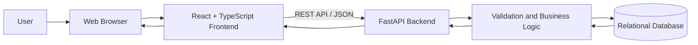
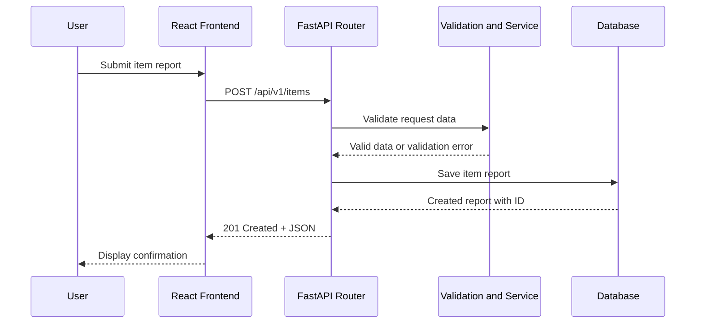
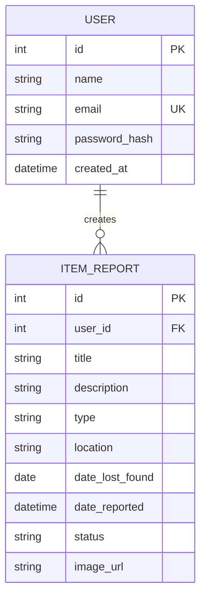
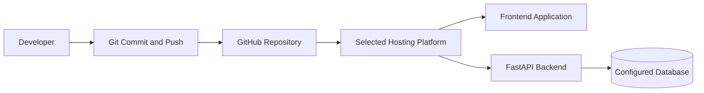

# Technical Design Document (TDD) — Lost & Found Platform

| Field        | Value                                                                          |
| ------------ | ------------------------------------------------------------------------------ |
| Product      | Lost & Found Platform                                                          |
| Version      | MVP + Beta                                                                     |
| Releases     | MVP — Core lost-and-found features; Beta — Extended features                   |
| Status       | Draft                                                                          |
| Frontend     | React + TypeScript                                                             |
| Backend      | Python + FastAPI                                                               |
| Database     | Relational database — final selection pending                                  |
| Related docs | Product Requirements Document (PRD), Software Requirements Specification (SRS) |

The MVP focuses on reporting, browsing, searching, and viewing lost and found items. The Beta release may extend the system with authentication, user dashboards, image uploads, notifications, and administrative moderation, depending on the final project scope.

## Documents in This Set

| Short form | Full form                           | Purpose                                    | File          |
| ---------- | ----------------------------------- | ------------------------------------------ | ------------- |
| PRD        | Product Requirements Document       | What we build and why                      | `docs/PRD.md` |
| SRS        | Software Requirements Specification | Functional and non-functional requirements | `docs/SRS.md` |
| TDD        | Technical Design Document           | How we build the system                    | `docs/TDD.md` |

## 1. Overview

* **MVP:** A web application that allows users to report lost and found items, browse reports, search for items, and view item details.
* **Beta:** The system may add user accounts, personal report management, image uploads, administrative moderation, and notifications.
* **Architecture:** React + TypeScript frontend communicating with a Python + FastAPI backend through REST APIs.
* **Data storage:** A relational database will store item reports and, if authentication is implemented, user information.
* **Development:** Git and GitHub will be used for version control, feature branches, issues, and pull requests.

The main objective is to provide an organized platform where information about lost and found belongings can be shared and searched efficiently.

## 2. Tech Stack

| Layer               | Proposed choice                                                | Why                                                                       | Release |
| ------------------- | -------------------------------------------------------------- | ------------------------------------------------------------------------- | ------- |
| Frontend framework  | React                                                          | Component-based user interface                                            | MVP     |
| Frontend language   | TypeScript                                                     | Type safety and maintainable frontend code                                | MVP     |
| Backend framework   | FastAPI                                                        | REST API development, request validation, and automatic API documentation | MVP     |
| Backend language    | Python                                                         | Backend logic and data processing                                         | MVP     |
| API format          | REST + JSON                                                    | Communication between frontend and backend                                | MVP     |
| Database            | PostgreSQL (proposed)                                          | Relational storage for item reports and user records                      | MVP     |
| ORM                 | SQLModel or SQLAlchemy (to be finalized)                       | Database access and model management                                      | MVP     |
| Version control     | Git and GitHub                                                 | Source control and project workflow                                       | MVP     |
| Testing             | Pytest and manual frontend testing                             | Checking backend functionality and user flows                             | MVP     |
| Authentication      | JWT or secure session-based authentication (to be finalized)   | User authentication if required                                           | Beta    |
| Image storage       | Local storage during development or a suitable storage service | Storing item photographs if supported                                     | Beta    |
| Database migrations | Alembic, if SQLAlchemy/SQLModel is selected                    | Managing schema changes                                                   | Beta    |
| Deployment          | Hosting platform to be selected                                | Making the application accessible online                                  | Beta    |

The final database, ORM, image-storage service, authentication mechanism, and hosting provider will be confirmed before their implementation.

## 3. Architecture

The application will follow a client-server architecture.

The browser displays the React application. The frontend sends HTTP requests to the FastAPI backend, which validates the requests, applies business rules, and communicates with the database.

### 3.1 System Architecture



**Component responsibilities:**

* **Frontend:** Displays item listings, search forms, report forms, and item details.
* **Backend:** Processes API requests, validates data, enforces permissions, and manages item records.
* **Database:** Persists item reports and related information.
* **Optional storage service:** Stores item images if image uploads are included.

### 3.2 Request Flow — MVP

When a user submits a lost-item report:

1. The user fills out the report form in the frontend.
2. React validates required fields and sends a `POST` request.
3. FastAPI receives the request and validates the request body.
4. The backend service applies the item-reporting rules.
5. The database stores the new report.
6. The backend returns the created report with its identifier.
7. The frontend displays a confirmation message or the relevant error.



### 3.3 Authentication Flow — Beta

If user authentication is included, the application will use a secure authentication mechanism selected during implementation.

A typical login flow will be:

1. The user submits their email and password.
2. The backend validates the credentials.
3. The backend establishes an authenticated session or issues an access token.
4. The frontend uses the authenticated state for protected operations.
5. The backend checks the user's identity and permissions before allowing report modification or deletion.

The final token or session implementation will depend on the selected authentication design.

## 4. Project Structure

The repository will organize the frontend, backend, and documentation separately.

```text
WebProject/
├── docs/
│   ├── PRD.md
│   ├── SRS.md
│   └── TDD.md
├── frontend/
│   └── src/
│       ├── components/
│       │   ├── Navbar.tsx
│       │   ├── ItemCard.tsx
│       │   ├── SearchBar.tsx
│       │   └── ItemForm.tsx
│       ├── pages/
│       │   ├── HomePage.tsx
│       │   ├── LostItemsPage.tsx
│       │   ├── FoundItemsPage.tsx
│       │   ├── ItemDetailsPage.tsx
│       │   └── ReportItemPage.tsx
│       ├── services/
│       │   └── api.ts
│       ├── types/
│       │   └── item.ts
│       ├── utils/
│       ├── App.tsx
│       └── main.tsx
├── backend/
│   ├── app/
│   │   ├── main.py
│   │   ├── config.py
│   │   ├── database.py
│   │   ├── items/
│   │   │   ├── router.py
│   │   │   ├── schemas.py
│   │   │   ├── models.py
│   │   │   └── service.py
│   │   ├── users/
│   │   │   ├── router.py
│   │   │   ├── schemas.py
│   │   │   ├── models.py
│   │   │   └── service.py
│   │   └── admin/
│   │       └── router.py
│   ├── tests/
│   └── requirements.txt
├── .gitignore
└── README.md
```

This is the **proposed target structure**, not a claim that every file or folder already exists. Optional `users/` and `admin/` modules will be implemented only if those features are included.

### 4.1 Module Responsibilities

* **`main.py`:** Creates the FastAPI application and registers the API routers.
* **`config.py`:** Loads environment-specific settings.
* **`database.py`:** Configures the database connection and provides database sessions.
* **`items/router.py`:** Defines item-related API endpoints.
* **`items/schemas.py`:** Defines and validates request and response data.
* **`items/models.py`:** Defines database models for item reports.
* **`items/service.py`:** Contains item-related business logic and database operations.
* **`services/api.ts`:** Centralizes frontend API requests.
* **`types/item.ts`:** Defines TypeScript types for item data.
* **`components/`:** Contains reusable UI components.
* **`pages/`:** Contains the main application pages.
* **`tests/`:** Contains backend and integration tests.

The router handles HTTP requests, schemas validate data, models represent stored records, and the service layer handles business rules. This separation makes the application easier to test and maintain.

## 5. Data Model

The database will store information about lost and found items. The exact schema will be finalized alongside the SRS and implementation.

### 5.1 Item Report Table — MVP

| Column            | Suggested type    | Rules                                                    |
| ----------------- | ----------------- | -------------------------------------------------------- |
| `id`              | Integer           | Primary key, auto-increment                              |
| `title`           | Varchar(200)      | Required                                                 |
| `description`     | Text              | Required or optional according to final validation rules |
| `type`            | Varchar(10)       | `lost` or `found`                                        |
| `location`        | Varchar(255)      | Required                                                 |
| `date_lost_found` | Date              | Date the item was lost or found, if known                |
| `date_reported`   | Timestamp         | Time the report was created                              |
| `status`          | Varchar(20)       | Such as `active` or `resolved`                           |
| `image_url`       | Varchar, nullable | Optional image reference, if images are supported        |

The report identifier uniquely identifies each item report. The `type` field distinguishes lost-item reports from found-item reports.

### 5.2 User Table — Beta

If registration and login are included, a separate user table may be introduced.

| Column          | Suggested type | Rules                                               |
| --------------- | -------------- | --------------------------------------------------- |
| `id`            | Integer        | Primary key                                         |
| `name`          | Varchar(100)   | Required                                            |
| `email`         | Varchar(254)   | Required and unique                                 |
| `password_hash` | Varchar        | Stores a password hash, never a plain-text password |
| `created_at`    | Timestamp      | Account creation time                               |
| `updated_at`    | Timestamp      | Last account update time                            |

In this design, item reports created by authenticated users will reference their creator through a `user_id` foreign key.

### 5.3 Relationships — Beta



**Relationship:** One user may create multiple item reports. Each authenticated user's report will reference the user who created it.

For the MVP, if the application does not require user accounts, the `user_id` relationship will be omitted.

### 5.4 Data Validation Rules

* The item title must not be empty.
* The item type must be either `lost` or `found`.
* Required fields must be validated on the backend.
* Item descriptions and other text fields must respect defined length limits.
* Invalid dates and unsupported values must be rejected.
* Item identifiers must refer to existing reports.
* If image uploads are implemented, the file type and size must be validated.
* If authentication is implemented, passwords must be securely hashed.

## 6. REST API Design

The backend will expose REST endpoints under the `/api/v1` prefix. Request and response bodies will use JSON unless a supported file-upload endpoint requires multipart form data.

### 6.1 Endpoints — MVP

| Method | Path                             | Purpose                            | Success       | Common errors                       |
| ------ | -------------------------------- | ---------------------------------- | ------------- | ----------------------------------- |
| `POST` | `/api/v1/items`                  | Create a lost or found item report | `201 Created` | `422`                               |
| `GET`  | `/api/v1/items`                  | Retrieve item reports              | `200 OK`      | `422`                               |
| `GET`  | `/api/v1/items/{item_id}`        | Retrieve one item's details        | `200 OK`      | `404`                               |
| `GET`  | `/api/v1/items?type=lost`        | Retrieve lost-item reports         | `200 OK`      | `422`                               |
| `GET`  | `/api/v1/items?type=found`       | Retrieve found-item reports        | `200 OK`      | `422`                               |
| `GET`  | `/api/v1/items?search={keyword}` | Search reports by keyword          | `200 OK`      | `422`                               |
| `GET`  | `/api/health`                    | Check backend availability         | `200 OK`      | `500` if an internal failure occurs |

The `type` and `search` parameters are query parameters for the item-listing endpoint and may be combined.

### 6.2 Endpoints — Beta

The following endpoints are proposed only if the corresponding features are included in the final scope.

| Method   | Path                             | Purpose                             | Success          | Common errors              |
| -------- | -------------------------------- | ----------------------------------- | ---------------- | -------------------------- |
| `POST`   | `/api/v1/auth/signup`            | Register a user                     | `201 Created`    | `409`, `422`               |
| `POST`   | `/api/v1/auth/login`             | Authenticate a user                 | `200 OK`         | `401`, `422`               |
| `GET`    | `/api/v1/users/me`               | Retrieve the current user's profile | `200 OK`         | `401`                      |
| `GET`    | `/api/v1/users/me/items`         | Retrieve the user's own reports     | `200 OK`         | `401`                      |
| `PATCH`  | `/api/v1/items/{item_id}`        | Update an authorized report         | `200 OK`         | `401`, `403`, `404`, `422` |
| `DELETE` | `/api/v1/items/{item_id}`        | Delete an authorized report         | `204 No Content` | `401`, `403`, `404`        |
| `PATCH`  | `/api/v1/items/{item_id}/status` | Update a report's status            | `200 OK`         | `401`, `403`, `404`, `422` |
| `GET`    | `/api/v1/admin/items`            | Retrieve reports for moderation     | `200 OK`         | `401`, `403`               |

The exact routes and permissions will be aligned with the final SRS. In particular, report updates and deletion must not be exposed without suitable authorization when the application uses user accounts.

### 6.3 Example — Create an Item Report

**Request**

```http
POST /api/v1/items
Content-Type: application/json
```

```json
{
  "title": "Black Backpack",
  "description": "A black backpack was lost on campus.",
  "type": "lost",
  "location": "University Campus",
  "date_lost_found": "2026-10-08"
}
```

**Example successful response**

```http
201 Created
```

```json
{
  "id": 1,
  "title": "Black Backpack",
  "description": "A black backpack was lost on campus.",
  "type": "lost",
  "location": "University Campus",
  "date_lost_found": "2026-10-08",
  "status": "active"
}
```

The response is illustrative. The final response fields will be determined by the implemented schema.

### 6.4 Example — Search Reports

```http
GET /api/v1/items?type=lost&search=backpack
```

The backend will filter item reports according to the supplied type and search keyword. If no matching reports exist, the API will return an empty list rather than treating a valid search as an error.

### 6.5 Error Response Format

The backend will use appropriate HTTP status codes and a consistent JSON error format.

Example:

```json
{
  "detail": "Item not found"
}
```

| Status | Meaning                                     |
| ------ | ------------------------------------------- |
| `200`  | Request completed successfully              |
| `201`  | Resource created successfully               |
| `204`  | Operation completed with no response body   |
| `400`  | Invalid request                             |
| `401`  | Authentication required                     |
| `403`  | Operation not permitted                     |
| `404`  | Requested resource not found                |
| `409`  | Conflict, such as a duplicate account email |
| `422`  | Request validation failed                   |
| `500`  | Internal server error                       |

FastAPI's validation responses may use its default detailed validation format. Internal exception details and sensitive configuration information must not be exposed to users.

### 6.6 API Design Rules

* Use plural resource names such as `/items`.
* Use HTTP methods according to the operation being performed.
* Keep request and response structures consistent.
* Validate all incoming data on the backend.
* Use pagination for item listings when needed.
* Use `404` when a requested report does not exist.
* Check ownership and permissions before modifying protected resources.
* Maintain the `/api/v1` prefix for future API versioning.

## 7. Database Access

The backend will use a database access layer to separate database operations from HTTP request handling.

* Database configuration will be loaded from environment variables.
* A database session will be created for each request that needs database access.
* The service layer will use the selected ORM or database library to create and retrieve records.
* Database transactions will be used for operations that require consistent updates.
* Database credentials will not be committed to the GitHub repository.
* Database schema changes will be managed carefully as the application grows.

PostgreSQL is the proposed database for this design. A local development database may be used if it is compatible with the selected ORM and configuration. The final database choice must be confirmed before implementation.

## 8. Configuration

Configuration values will be stored outside the application source code.

| Variable                                    | Purpose                                                    | Release |
| ------------------------------------------- | ---------------------------------------------------------- | ------- |
| `DATABASE_URL`                              | Database connection string                                 | MVP     |
| `APP_ENV`                                   | Identifies the development or production environment       | MVP     |
| `FRONTEND_ORIGIN`                           | Configures permitted frontend origin when CORS is required | MVP     |
| `SECRET_KEY` or `JWT_SECRET`                | Secret used by the selected authentication mechanism       | Beta    |
| `UPLOAD_DIRECTORY` or storage configuration | Location or settings for item images                       | Beta    |

These variable names are proposed and may be adjusted during implementation.

* A local `.env` file may be used for development.
* The `.env` file must be excluded from Git using `.gitignore`.
* Production secrets must be configured through the hosting platform's environment settings.
* Secret values must never be included in frontend source code or committed to GitHub.
* CORS must be configured appropriately if the frontend and backend use different origins.

## 9. Deployment

The application will be deployed after local testing and configuration are complete. The hosting platform has not yet been finalized.

### 9.1 Deployment Flow



### 9.2 Deployment Considerations

* Configure the frontend and backend URLs correctly.
* Set production environment variables through the hosting provider.
* Configure CORS when frontend and backend origins differ.
* Ensure the deployed backend can connect securely to the database.
* Test the main user flows after deployment.
* Do not expose database credentials or authentication secrets.
* Confirm that uploaded images, if supported, are stored in a location suitable for the deployment environment.

The final hosting platform, production database, and deployment configuration will be selected according to project requirements and available resources.

## 10. Authentication and Authorization — Beta

Authentication and authorization will be implemented if they are part of the approved project scope.

### 10.1 Authentication

The system may provide registration and login functionality for users.

* Users will authenticate using their registered credentials.
* Passwords will be stored as secure password hashes.
* Authentication credentials or tokens will be handled securely.
* Protected API endpoints will verify the authenticated user's identity.
* The system will return appropriate errors for invalid or expired credentials.

The final session or token mechanism will be selected during implementation.

### 10.2 Authorization Rules

| Operation                  | Proposed permission                          |
| -------------------------- | -------------------------------------------- |
| Browse public item reports | Public, unless requirements change           |
| Search item reports        | Public, unless requirements change           |
| View item details          | Public, unless requirements change           |
| Create a report            | According to the final authentication policy |
| Update a report            | Report owner or authorized administrator     |
| Delete a report            | Report owner or authorized administrator     |
| Moderate reports           | Authorized administrator                     |

These are proposed permissions. The final behavior must match the SRS and the actual features selected for development.

### 10.3 Administrative Moderation — Optional Beta Feature

If moderation is included, administrators may be able to review reports and remove inappropriate or invalid content.

Administrative endpoints must verify administrator permissions on the backend. Hiding an administrative button in the frontend is not sufficient security.

## 11. Security Design

Security controls will be applied throughout development.

| Area               | Design                                                                     |
| ------------------ | -------------------------------------------------------------------------- |
| Input validation   | Validate incoming fields on the backend                                    |
| Authentication     | Securely verify users if accounts are implemented                          |
| Passwords          | Use a suitable password-hashing algorithm                                  |
| Authorization      | Check ownership and permissions on protected operations                    |
| Database access    | Use parameterized queries through the selected ORM or database library     |
| Secrets            | Keep database credentials and secret keys in environment variables         |
| Error handling     | Return safe error messages without exposing internal details               |
| Image uploads      | Validate file type and size if uploads are supported                       |
| Transport security | Use HTTPS in production                                                    |
| CORS               | Allow only appropriate origins when cross-origin access is required        |
| Data privacy       | Avoid exposing private user information in public reports or API responses |

The application will collect only information needed for its intended functionality. Contact information, if included in item reports, must be handled according to the final privacy and security requirements.

## 12. Database Migrations — If Required

If the selected database and ORM require migration tooling, database schema changes will be managed through versioned migration scripts.

* The initial migration will create the item-report table.
* A later migration may add user accounts and report ownership.
* Additional migrations may support moderation, notifications, or other approved features.
* Migration scripts will be reviewed and tested before being applied to production.
* Existing data must be preserved when schema changes require it.

Alembic is a possible choice if SQLAlchemy or SQLModel is selected. Migration tooling and commands will be finalized after the database configuration is established.

## 13. Testing Strategy

Testing will verify that the application behaves according to the SRS.

### 13.1 Backend Testing

* Test successful item-report creation.
* Test retrieval of item listings and individual reports.
* Test lost/found type filtering.
* Test keyword search.
* Test invalid and missing input.
* Test requests for nonexistent item identifiers.
* Test authorization rules if authentication is implemented.
* Test database operations and error handling.

### 13.2 Frontend Testing

* Verify that the main pages render correctly.
* Test navigation between the home page and item listings.
* Test report form validation.
* Verify that search and filters display appropriate results.
* Check loading indicators and error messages.
* Confirm that the interface works on common screen sizes.

### 13.3 Integration Testing

* Confirm that the frontend can communicate with the backend.
* Verify that a newly created report can be retrieved.
* Confirm that search results reflect the stored reports.
* Check that backend validation errors are displayed appropriately.
* Verify protected operations when authentication is included.

### 13.4 Acceptance Testing

The main user flows will be tested against the acceptance criteria defined in the SRS. A feature will be considered ready when its required behavior is implemented and the relevant tests pass.

## 14. Development Workflow

Git and GitHub will be used to manage project changes.

1. Create or select the appropriate GitHub issue.
2. Work on a feature branch linked to the issue.
3. Implement a focused change.
4. Test the change where applicable.
5. Commit changes with meaningful commit messages.
6. Push the branch to GitHub.
7. Open or update the pull request.
8. Review the changes against the project requirements.
9. Merge only after the required review and approval.

For the current documentation assignment, PRD, SRS, and TDD will remain inside the `docs/` directory and be committed to the existing documentation branch and pull request.

## 15. Risks and Mitigation

| Risk                                                    | Mitigation                                                                     |
| ------------------------------------------------------- | ------------------------------------------------------------------------------ |
| Users submit incomplete or invalid reports              | Validate data on both frontend and backend                                     |
| Search returns irrelevant results                       | Define consistent search fields and filtering rules                            |
| Unauthorized users modify reports                       | Enforce ownership and authorization on the backend                             |
| Database credentials are exposed                        | Store secrets in environment variables and exclude `.env` from Git             |
| Uploaded files contain unsafe content                   | Validate file types, file sizes, and storage access if uploads are supported   |
| Frontend and backend become difficult to maintain       | Keep UI components, API routes, schemas, and services separate                 |
| Database schema changes break existing data             | Test migrations and preserve existing records                                  |
| Deployment configuration differs from local development | Test environment variables, API URLs, and database connectivity before release |
| Optional features increase project complexity           | Prioritize MVP requirements before implementing Beta enhancements              |
| Requirements and implementation become inconsistent     | Review the PRD, SRS, and TDD together during development                       |

## 16. Future Enhancements

The following features may be considered after the MVP is completed:

* User registration and login.
* Personal dashboards for managing reports.
* Image uploads for lost and found items.
* More advanced search and filtering.
* Notifications for potentially matching reports.
* Administrative report moderation.
* Improved matching of lost and found items.
* Additional deployment and monitoring improvements.

These features are proposals, not commitments. They will be included only if approved by the project requirements and available development time.

## 17. Conclusion

This Technical Design Document defines the proposed architecture and implementation approach for the Lost & Found Platform. The application will use React and TypeScript for the frontend and Python with FastAPI for the backend. A relational database is proposed for storing item reports and related information.

The design separates frontend components, API routes, validation schemas, business logic, and database operations. It also establishes guidelines for security, testing, deployment, and future enhancements.

The final implementation must remain consistent with the approved PRD and SRS. Optional features, database technology, authentication, image storage, and hosting arrangements will be confirmed before they are implemented.

